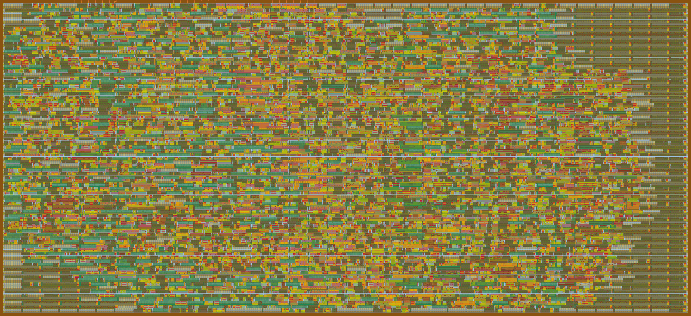
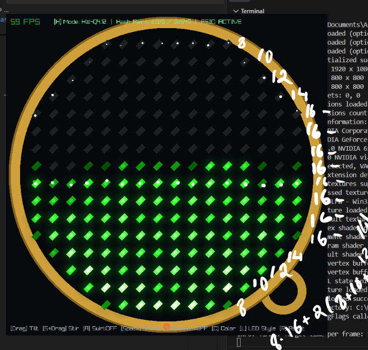
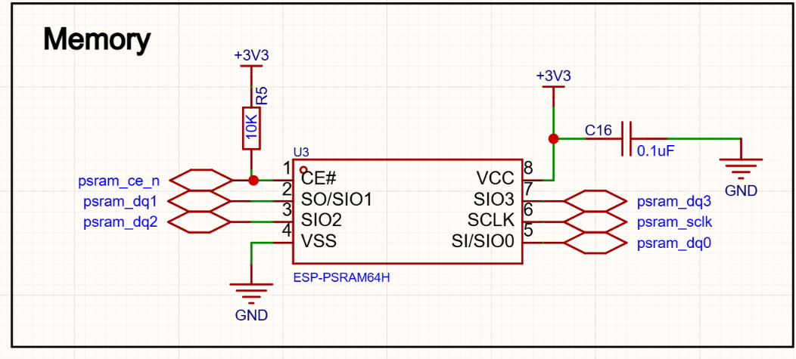
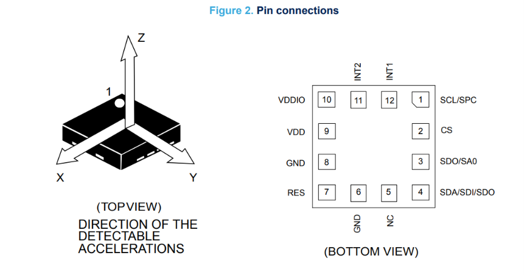
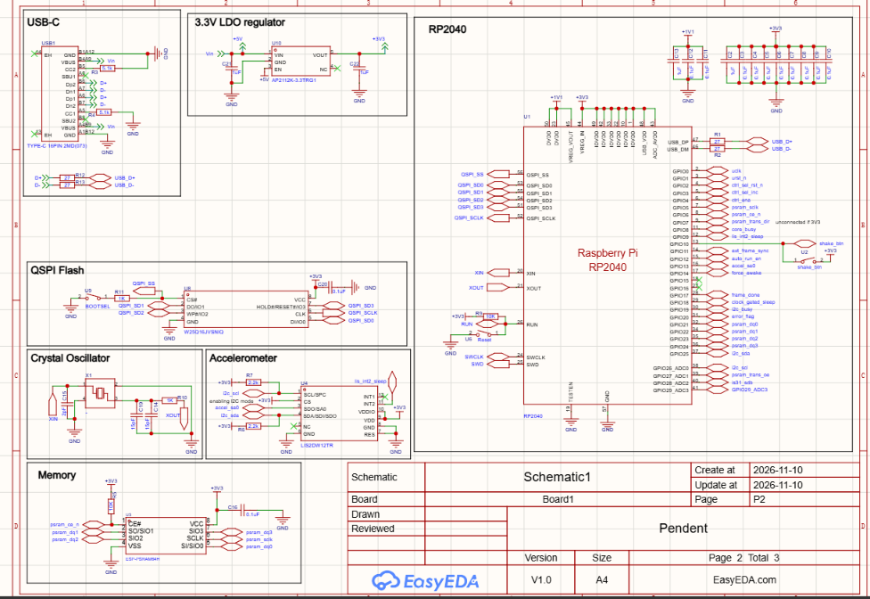

<!---
This file is used to generate your project datasheet. Please fill in the information below and delete any unused
sections.
-->

## How it works

`tt_um_flip_pendant` is a dedicated hardware implementation of a 256-particle Q4.12 fixed-point PIC/FLIP fluid simulation. It is being developed for PENDENT, a pendant with a 16x16 circular LED display containing 216 active LEDs.

The ASIC performs the fluid simulation. The simulation uses particle and grid-based calculations, with Q4.12 fixed-point arithmetic to represent values in hardware.



_The GF180MCU GDS render._

The RP2040 is a separate component on the pendant's single PCB. In the current design, its only responsibility is selecting PENDENT's tile on the shared Tiny Tapeout chip. It does not run the fluid simulation or handle the ASIC's general communication. Its responsibilities may change in a later revision, but tile selection is all it does at present.

## How to test

1. Generate `src/project.v` from the Amaranth RTL bundle:
   ```bash
   python tb.py --export-only
   cp build/standalone_tb/project.v src/project.v
   ```
2. Run the standalone 10-frame Verilator differential test suite:
   ```bash
   python tb.py --frames 10 --seed 1
   ```
3. Run the Tiny Tapeout Cocotb testbench inside `test/`:
   ```bash
   cd test && make -B
   ```

## External hardware

The pendant's external hardware is designed around the ASIC and is mounted on the same PCB.

### Display

The display is a circular arrangement of 216 monochrome LEDs, mapped onto a 16x16 grid with no centre LED.



_The 216-LED layout._

- **ESP-PSRAM64H** — 3.3V, 64 Mbit (8 MB) external QPI PSRAM intended for the simulation's working memory.



- **LIS2DW12** — 3-axis accelerometer, intended for movement detection and shake-to-wake.



- **HT16D33B** — the current LED-driver choice for the 216 monochrome LEDs. It replaces the earlier IS31FL3741A choice because its 16x16 arrangement better suits the display mapping.
- **RP2040** — currently used only to select PENDENT's tile on the shared Tiny Tapeout chip.



- **W25Q16JV** — 16 Mbit (2 MB) QSPI flash. It is intended for the RP2040 firmware, based on the devboard guide used for the design.

The carrier-board schematic still needs to be updated for the HT16D33B, and the PCB layout has not yet been completed.
